<h1 align="center">Dynamic reach extension of a Cartesian impedance-controlled robot on a compliant base via machine learning</h1>

<p align="center">
  <b>Course 062119 – Machine Learning for Mechanical Systems · Politecnico di Milano · A.Y. 2025/26</b> Department of Mechanical Engineering
</p>

<p align="center">
  
  
  
  
  <br/>
  
  
  
  
</p>

<p align="center">
  <i>Gaussian Process surrogates · Bayesian Optimization · Neural network surrogates · Inverse design</i><br/>
  Pietro Maria Ghisi · Yuxuan Lu · Erwin Rafael Novicio — Advisor: Prof. Loris Roveda
</p>

---

## Table of contents

1. [Problem statement](#1-problem-statement)
2. [Overall ML pipeline](#2-overall-ml-pipeline)
3. [Physical model](#3-physical-model)
4. [Approach 1 – Semi-brute-force baseline (LHS + Differential Evolution)](#4-approach-1--semi-brute-force-baseline-lhs--differential-evolution)
5. [Approach 2 – Gaussian Process surrogate + Bayesian Optimization](#5-approach-2--gaussian-process-surrogate--bayesian-optimization)
6. [Approach 3 – Neural network surrogate](#6-approach-3--neural-network-surrogate)
7. [Comparison of approaches](#7-comparison-of-approaches)
8. [Key takeaways and future work](#8-key-takeaways-and-future-work)
9. [Tech stack](#9-tech-stack)
10. [References](#10-references)

---

## 1. Problem statement

A **Cartesian impedance-controlled robot mounted on a compliant base** is modelled as a **two-mass-spring-damper system in series**:

| | Mass | Degree of freedom | Controllable? |
|---|---|---|---|
| Robot base | $`M_b`$ | $`x_b`$ (absolute displacement) | ❌ passive: only base compliance and damping act on it |
| Robot end effector | $`M_r`$ | $`x_r`$ (displacement relative to the base) | ✅ actuated, through a bounded commanded position $`x_{cmd}`$ |

<p align="center">
  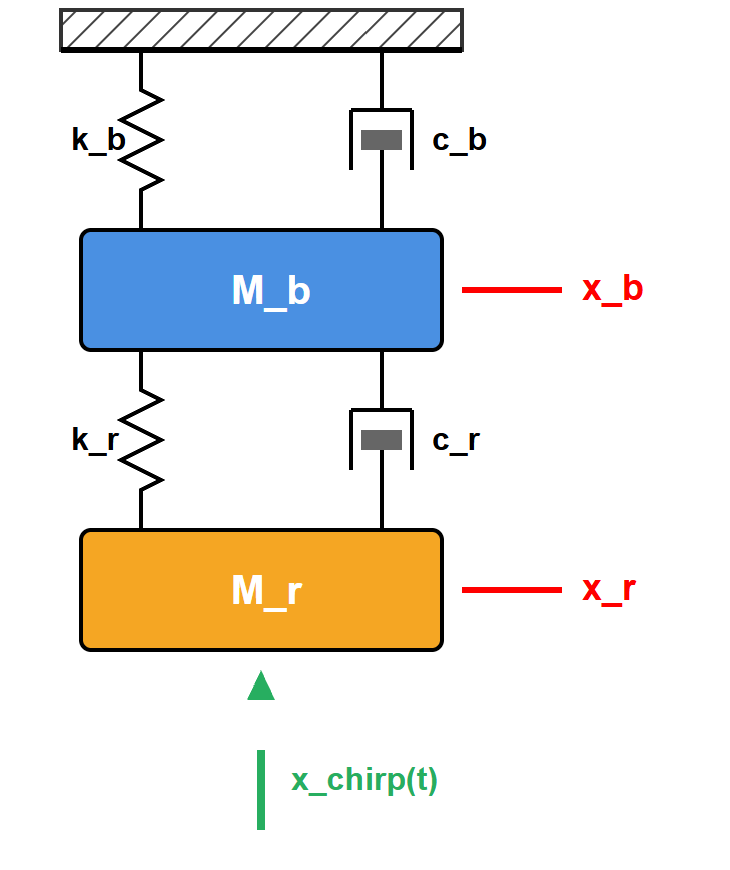
</p>

The commanded position of the end effector is **bounded** (the robot's nominal workspace). The goal is to **reach a target position beyond that nominal reach** by **exciting the passive DOF**: the robot drives its own base into resonance and uses the base motion to push the end effector further than it could reach with the base held still.

The task is set up as two optimization problems over a 9-dimensional design/control space:

- **Direct problem:** what is the *maximum* end-effector displacement the system can reach?
- **Inverse problem:** for a *given base* (fixed $`K_b, M_b, h_b`$) and a *target displacement*, which robot and excitation parameters reach exactly that target?

Running the ODE solver for every candidate is slow. The ML methods replace the solver with **fast learned surrogates** so the optimization becomes cheap.

---

## 2. Overall ML pipeline

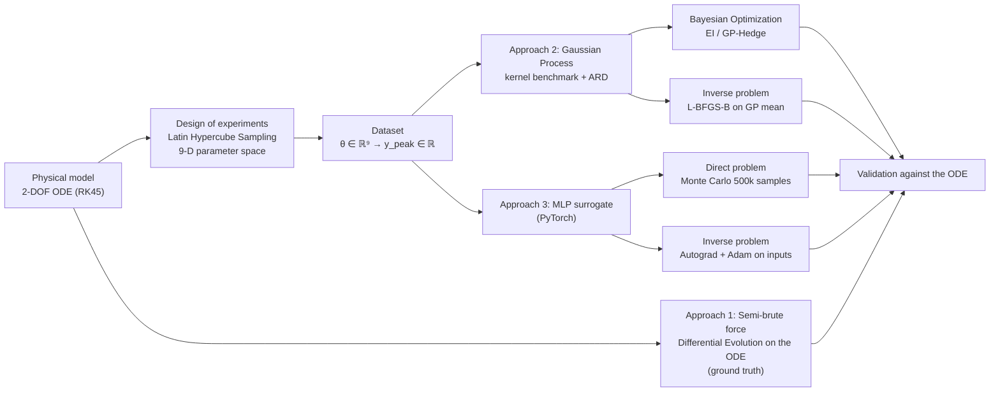

| Approach | Model input | Model output | Role in the pipeline |
|---|---|---|---|
| **1. Semi-brute force** | $`\boldsymbol\theta`$ (9 parameters) | $`y_{peak}`$ from the ODE | Ground-truth benchmark for direct and inverse problems |
| **2. GP + BO** | $`\boldsymbol\theta`$ (scaled) | $`\mu(\boldsymbol\theta)`$, $`\sigma(\boldsymbol\theta)`$ of $`y_{peak}`$ | Probabilistic surrogate. Its uncertainty drives the sample-efficient search; ARD length-scales give a sensitivity analysis |
| **3. Neural network** | $`\boldsymbol\theta`$ (normalized to $`[0,1]^9`$) | $`\hat y_{peak}`$ | Very fast, differentiable surrogate for massive sampling and gradient-based inverse design |

---

## 3. Physical model

### 3.1 Equations of motion (Lagrangian approach)

The equations come from Lagrange's equations with a Rayleigh dissipation function, with generalized coordinates $`\bar{x} = [x_b,\ x_r]^T`$:

```math
\frac{d}{dt}\left(\frac{\partial T}{\partial \dot{\bar{x}}}\right) - \frac{\partial T}{\partial \bar{x}} + \frac{\partial D}{\partial \dot{\bar{x}}} + \frac{\partial V}{\partial \bar{x}} = \bar{0}
```

```math
T = \tfrac{1}{2} M_b \dot{x}_b^2 + \tfrac{1}{2} M_r \left(\dot{x}_b + \dot{x}_r\right)^2, \qquad
D = \tfrac{1}{2} c_b \dot{x}_b^2 + \tfrac{1}{2} c_r \dot{x}_r^2, \qquad
V = \tfrac{1}{2} K_b x_b^2 + \tfrac{1}{2} K_r \left(x_r - x_{cmd}\right)^2
```

The impedance controller acts as a virtual spring–damper ($`K_r`$, $`c_r`$) that pulls the end effector toward the commanded position $`x_{cmd}`$. This gives:

```math
\begin{cases}
M_b \ddot{x}_b + c_b \dot{x}_b + K_b x_b = K_r\,(x_r - x_{cmd}) + c_r \dot{x}_r & \text{(base)}\\[4pt]
M_r\,(\ddot{x}_b + \ddot{x}_r) + c_r \dot{x}_r + K_r x_r = K_r\, x_{cmd} & \text{(robot)}
\end{cases}
```

The initial conditions are zero, except for the initial position. The **absolute end-effector position** is $`y(t) = x_b(t) + x_r(t)`$.

### 3.2 State-space formulation

With state $`\bar{x} = [\dot{x}_b,\ \dot{x}_r,\ x_b,\ x_r]^T`$ and input $`u = x_{cmd}`$, the system is $`\dot{\bar{x}} = A\bar{x} + Bu`$:

```math
A =
\begin{bmatrix}
-\dfrac{c_b}{M_b} & \dfrac{c_r}{M_b} & -\dfrac{K_b}{M_b} & \dfrac{K_r}{M_b} \\[8pt]
\dfrac{c_b}{M_b} & -c_r\left(\dfrac{1}{M_b}+\dfrac{1}{M_r}\right) & \dfrac{K_b}{M_b} & -K_r\left(\dfrac{1}{M_b}+\dfrac{1}{M_r}\right) \\[8pt]
1 & 0 & 0 & 0 \\
0 & 1 & 0 & 0
\end{bmatrix},
\qquad
B =
\begin{bmatrix}
-\dfrac{K_r}{M_b} \\[8pt]
K_r\left(\dfrac{1}{M_b}+\dfrac{1}{M_r}\right) \\[8pt]
0 \\ 0
\end{bmatrix}
```

The system is integrated with an explicit **Runge–Kutta 4(5) (RK45)** solver.

### 3.3 Damping parametrization

Damping is expressed through **non-dimensional damping ratios** $`h_b`$, $`h_r`$. This makes the parameters physically interpretable and easy to bound. Assuming well-separated resonance peaks:

```math
c_b = 2\,h_b\,M_b\,\omega_b = 2\,h_b\sqrt{K_b M_b}, \qquad
c_r = 2\,h_r\,M_r\,\omega_r = 2\,h_r\sqrt{K_r M_r}, \qquad
\omega = \sqrt{K/M}
```

### 3.4 Excitation: linear chirp

The end effector is commanded with a **linear frequency sweep** from $`f_0`$ to $`f_1`$ over the simulation time $`T_{sim}`$. The sweep passes through the system's resonances, and that is what pumps energy into the passive base.

```math
k = \frac{f_1 - f_0}{T_{sim}}, \qquad f(t) = f_0 + k t, \qquad
\phi(t) = 2\pi\!\int_0^t (f_0 + k\tau)\,d\tau = 2\pi\left(f_0 t + \tfrac{1}{2} k t^2\right)
```

```math
x_{cmd}(t) = x_{r,start} + A_{sin}\cos\!\Big(2\pi\big(f_0 t + \tfrac{1}{2} k t^2\big)\Big)
```

Since $`x_{r,start} \le 0.5`$ m and $`A_{sin} \le 0.2`$ m, the **nominal reach of the robot is about 0.7 m**. Anything beyond that comes from the dynamics.

### 3.5 Design space

Nine parameters govern the problem:

```math
\boldsymbol\theta = \big[K_b,\ K_r,\ M_b,\ h_b,\ h_r,\ f_0,\ f_1,\ A_{sin},\ x_{r,start}\big]^T \in \mathcal{X} \subset \mathbb{R}^9
```

| Parameter | Meaning | Lower bound | Upper bound | Unit |
|---|---|---|---|---|
| $`K_b`$ | base stiffness | 100 | 5000 | N/m |
| $`K_r`$ | robot impedance stiffness | 100 | 5000 | N/m |
| $`M_b`$ | base mass | 10 | 100 | kg |
| $`h_b`$ | base damping ratio | 0.1 | 0.3 | – |
| $`h_r`$ | robot damping ratio | 0.1 | 1.1 | – |
| $`f_0`$ | chirp start frequency | $`10^{-4}`$ | $`10^{-2}`$ | Hz |
| $`f_1`$ | chirp end frequency | 3 | 10 | Hz |
| $`A_{sin}`$ | chirp amplitude | 0.1 | 0.2 | m |
| $`x_{r,start}`$ | commanded offset | 0.3 | 0.5 | m |

Fixed: $`M_r = 10`$ kg, $`T_{sim} = 20`$ s, sampling time $`T_s = 0.05`$ s.

**Objective (performance index)**, the peak absolute end-effector displacement:

```math
f(\boldsymbol\theta) = \max_{t\in[0,T_{sim}]} y(t;\boldsymbol\theta) = \max_{t\in[0,T_{sim}]} \big[x_b(t;\boldsymbol\theta) + x_r(t;\boldsymbol\theta)\big]
```

---

## 4. Approach 1 – Semi-brute-force baseline (LHS + Differential Evolution)

A full grid search over 9 dimensions would need millions of ODE simulations. Local gradient methods, on the other hand, get trapped because the response surface is **non-convex** (several resonance basins). The semi-brute-force (SB) method combines the two ideas:

1. **Latin Hypercube Sampling (LHS)** of the 9-D space ($`N = 10\,000`$ samples) to map the response distribution.
2. **Differential Evolution (DE)**, a population-based global optimizer, run **directly on the RK45 solver**. It gives an *unbiased ground truth* without any model approximation.

<p align="center">
  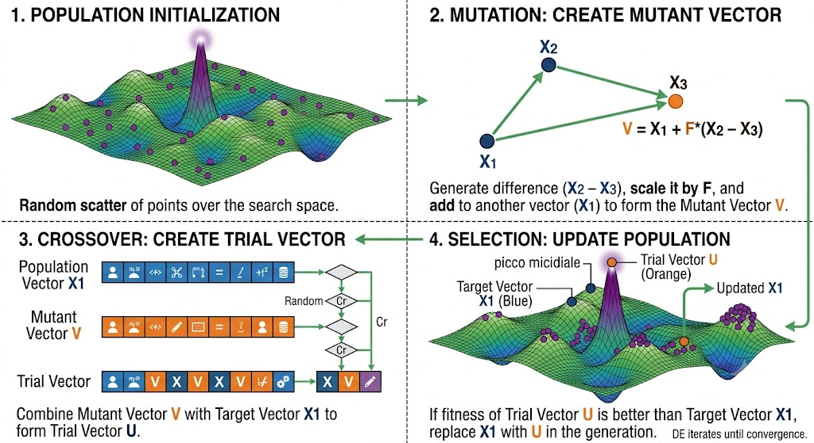
</p>

The LHS dataset already shows that random designs rarely exceed the nominal reach. The distribution peaks around 0.6 m and has a long right tail of rare resonant configurations, which is exactly where the optimizer has to go:

<p align="center">
  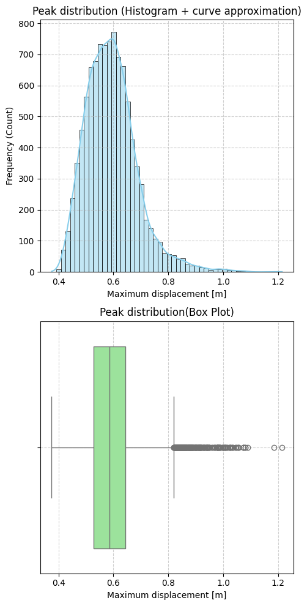
</p>

### 4.1 Direct optimization (maximum reach)

DE minimizes $`-f(\boldsymbol\theta)`$ over the full 9-D space.

| Parameter | Optimal value |
|---|---|
| $`K_b`$ | 4889.12 N/m |
| $`K_r`$ | 2617.95 N/m |
| $`M_b`$ | 10.0 kg |
| $`h_b`$ | 0.1 |
| $`h_r`$ | 0.1 |
| $`f_0`$ | 0.0001 Hz |
| $`f_1`$ | 3.0 Hz |
| $`A_{sin}`$ | 0.2 m |
| $`x_{r,start}`$ | 0.5 m |
| **Max displacement** | **1.5772 m** |

**Interpretation:** the end effector reaches **1.58 m, more than twice the ~0.7 m nominal reach**. The optimizer sets both damping ratios and the base mass to their minimum, saturates the amplitude and offset bounds, and tunes the stiffnesses so the natural frequencies line up with the slow chirp. Several parameters end up on the bounds of the search space, so the design space limits the result. Cost: **about 5 minutes** for one direct optimization.

### 4.2 Inverse optimization (hit a target)

The base hardware ($`K_b, M_b, h_b`$) is **fixed**, and DE optimizes the 6 remaining robot and excitation parameters to minimize $`(f(\boldsymbol\theta) - y_{target})^2`$.

| Parameter | Value |
|---|---|
| $`K_b`$, $`M_b`$, $`h_b`$ (fixed) | 4889.12 N/m, 10.0 kg, 0.10 |
| $`K_r`$ | 4315.18 N/m |
| $`h_r`$ | 0.12 |
| $`f_0`$ / $`f_1`$ | 0.0029 Hz / 9.35 Hz |
| $`A_{sin}`$ | 0.17 m |
| $`x_{r,start}`$ | 0.49 m |
| **Target → achieved** | **1.12 m → 1.12002 m** (squared error $`2.7\cdot10^{-10}`$) |

To hit a sub-maximal target, the optimizer **backs off on excitation energy**: a smaller amplitude and a wider frequency sweep, so the system passes through resonance faster. It is very accurate but takes **about 1.4 minutes per target**. That cost is what motivates the surrogate models.

---

## 5. Approach 2 – Gaussian Process surrogate + Bayesian Optimization

### 5.1 Dataset and preprocessing

LHS samples $`\boldsymbol\theta^{(i)}`$ are simulated to build $`X \in \mathbb{R}^{n_s\times 9}`$, $`Y \in \mathbb{R}^{n_s}`$, which are then split into train and test sets. A `StandardScaler` is **fitted only on the training set** (to avoid data leakage) and applied to the test set and to the search bounds:

```math
x_{j,\text{scaled}} = \frac{x_j - \mu_j}{\sigma_j}, \qquad
\Delta x_{j,\text{scaled}} = \frac{u_j - l_j}{\sigma_j}
```

### 5.2 Kernel design

General kernel structure: signal variance × base kernel + white noise:

```math
k(\mathbf{x},\mathbf{x}') = \sigma^2\, k_{\text{basis}}(\mathbf{x},\mathbf{x}') + \sigma_n^2\,\delta(\mathbf{x},\mathbf{x}')
```

Candidate base kernels, ordered from least to most smooth: **Exponential** (Matérn ν = 1/2), **Matérn 3/2**, **Matérn 5/2**, **RBF**. All kernels use **Automatic Relevance Determination (ARD)**, with one length-scale $`l_j`$ per input dimension. Three heuristics were tested for the initial length-scales:

```math
l_j^{\text{short}} = 0.15\,\Delta x_{j,\text{scaled}}, \qquad
l_j^{\text{medium}} = 0.5\,\Delta x_{j,\text{scaled}}, \qquad
l_j^{\text{long}} = 1.0\,\Delta x_{j,\text{scaled}}
```

Hyperparameters $`\boldsymbol\delta = [\mathbf{l},\ \sigma^2,\ \sigma_n^2]`$ are learned by maximizing the log marginal likelihood, with **10 optimizer restarts** to avoid poor local optima:

```math
f(\boldsymbol\theta) \sim \mathcal{GP}\big(m(\boldsymbol\theta),\ k(\boldsymbol\theta,\boldsymbol\theta';\boldsymbol\delta)\big), \qquad
\boldsymbol\delta^* = \arg\max_{\boldsymbol\delta}\ \log p(Y \mid X, \boldsymbol\delta)
```

### 5.3 Kernel benchmark

Each configuration was scored on the test set:

```math
\text{RMSE} = \sqrt{\frac{1}{N}\sum_i (y_i - \hat{y}_i)^2}, \qquad
\text{MAE} = \frac{1}{N}\sum_i |y_i - \hat{y}_i|, \qquad
R^2 = 1 - \frac{\sum_i (y_i - \hat{y}_i)^2}{\sum_i (y_i - \bar{y})^2}
```

<p align="center">
  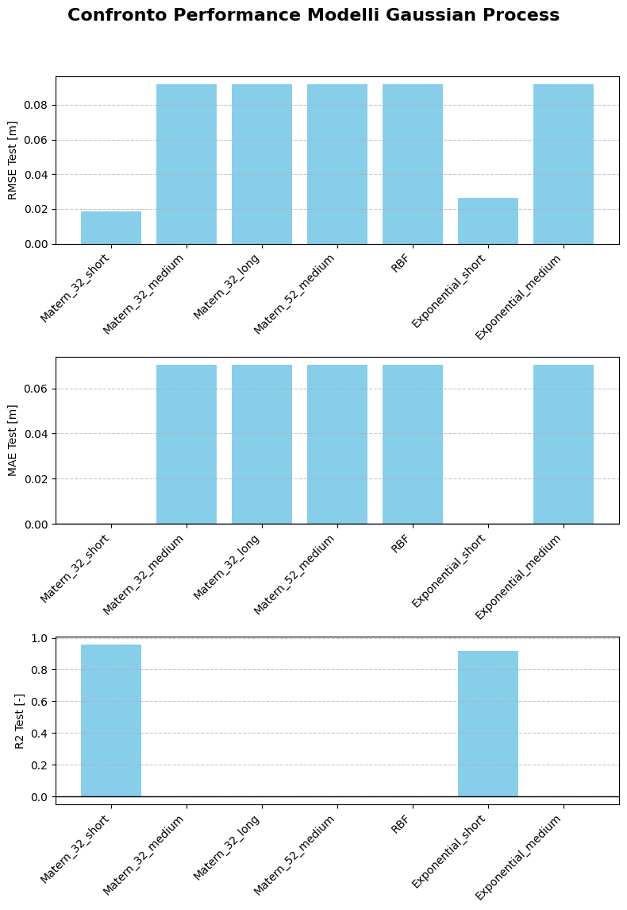
</p>

**Matérn 3/2 with short initial length-scales** wins with **RMSE = 0.018 m, MAE = 0.012 m, $`R^2`$ = 0.96**. Medium and long initializations **severely underfit**: the likelihood optimization over-smooths the response and cannot resolve the sharp, local resonance peaks. This is a good example of how a physics-informed prior (the response is rough near resonance) matters for model choice.

### 5.4 Surrogate validation

| Parity plot (test) | Residuals (test) |
|---|---|
| 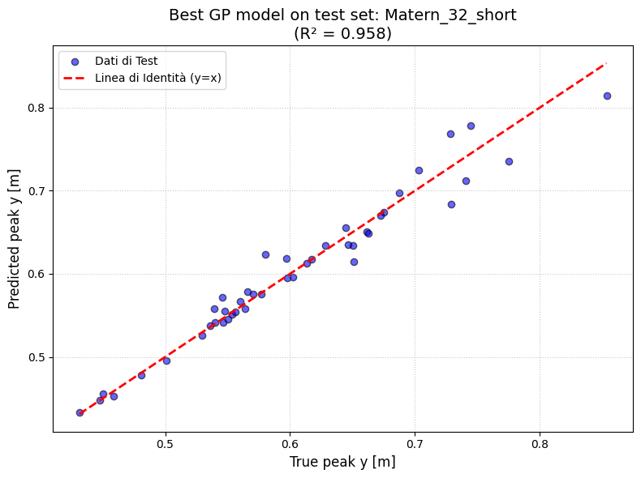 | 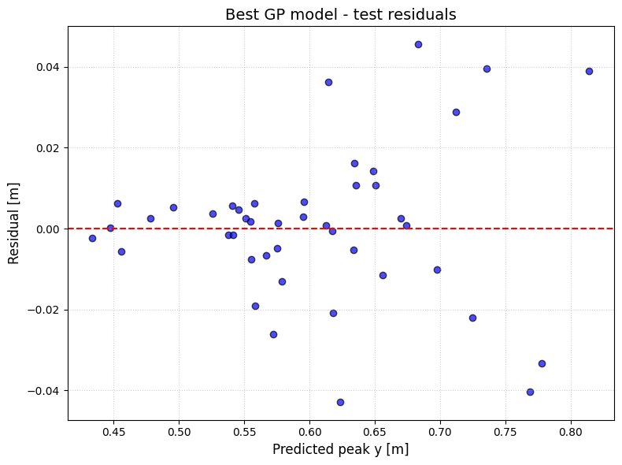 |

Residuals stay within **±0.04 m** with no visible bias. The predictive 95 % confidence band contains the true ODE response, so the GP is **well calibrated**. Variance grows slightly at high displacements, where the system is most sensitive near resonance:

<p align="center">
  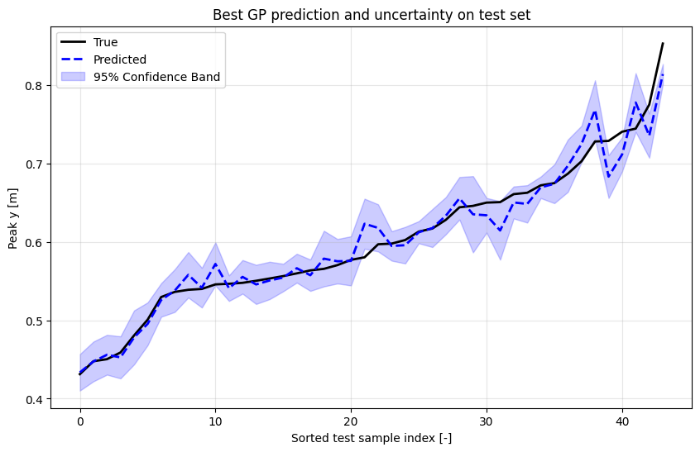
</p>

### 5.5 Physical insight from ARD length-scales

A short length-scale means the output is sensitive to that input. The normalized relevance weights are defined as:

```math
w_i = \frac{1}{l_i}, \qquad \bar{w}_i = \frac{w_i}{\sum_j w_j}
```

<p align="center">
  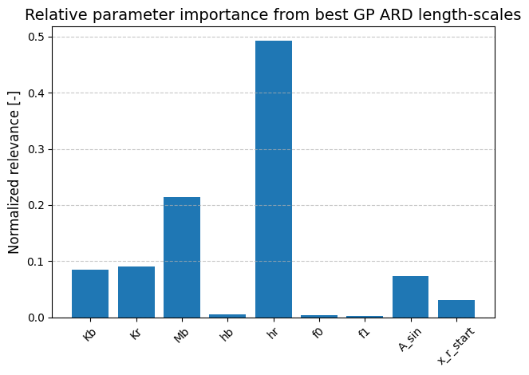
</p>

- **Robot damping ratio $`h_r`$ ≈ 49 %**: energy dissipation in the active joint dominates the reach.
- **Base mass $`M_b`$ ≈ 21 %**: it sets the base natural frequency and its alignment with the arm.
- $`K_b`$, $`K_r`$, $`A_{sin}`$ ≈ 8 % each. $`h_b`$ and the sweep frequencies contribute less than 1 %.

The surrogate therefore doubles as a **data-driven sensitivity analysis**, and it agrees with the physics: low dissipation and good base–arm frequency coupling are what extend the reach.

### 5.6 Bayesian Optimization – direct problem

BO is run in a **Min-Max normalized domain** $`[0,1]^9`$. Results are mapped back to physical units with the inverse transform. The tuned Matérn 3/2 GP from the benchmark is the **warm-started prior**: its hyperparameters stay trainable but start from data-informed values.

**Algorithm.** Implemented with `skopt.gp_minimize` on $`-f`$, using the custom GP regressor:

1. **Initial design:** $`D_m = \{(\boldsymbol\theta_i, y_i)\}_{i=1}^{m}`$, with $`m = 40`$ space-filling (LHS) points.
2. **Prior:** $`f(\boldsymbol\theta)\sim\mathcal{GP}(0, k(\boldsymbol\theta,\boldsymbol\theta'))`$.
3. **Loop** for $`t = m, \dots, 150`$:
   - Posterior: $`f(\boldsymbol\theta)\mid D_t \sim \mathcal{N}\big(\mu_t(\boldsymbol\theta),\ \sigma_t^2(\boldsymbol\theta)\big)`$. Hyperparameters are re-fitted by maximum marginal likelihood (L-BFGS, 10 restarts).
   - Acquisition: **Expected Improvement** (formula below) with exploration parameter $`\xi = 0.05`$ and incumbent $`f^* = \max_i y_i`$.
   - Next point: $`\boldsymbol\theta_{t+1} = \arg\max_{\boldsymbol\theta\in\mathcal{X}} \text{EI}(\boldsymbol\theta)`$, maximized with L-BFGS.
   - Evaluate the **real ODE**: $`y_{t+1} = f(\boldsymbol\theta_{t+1})`$, then update $`D_{t+1} = D_t \cup \{(\boldsymbol\theta_{t+1}, y_{t+1})\}`$.

Expected Improvement (maximization form) used in the acquisition step:

```math
\text{EI}(\boldsymbol\theta) = \mathbb{E}\big[\max(0,\ f(\boldsymbol\theta) - f^* - \xi)\big]
= (\mu_t - f^* - \xi)\,\Phi(Z) + \sigma_t\,\varphi(Z), \quad
Z = \frac{\mu_t - f^* - \xi}{\sigma_t}
```

<p align="center">
  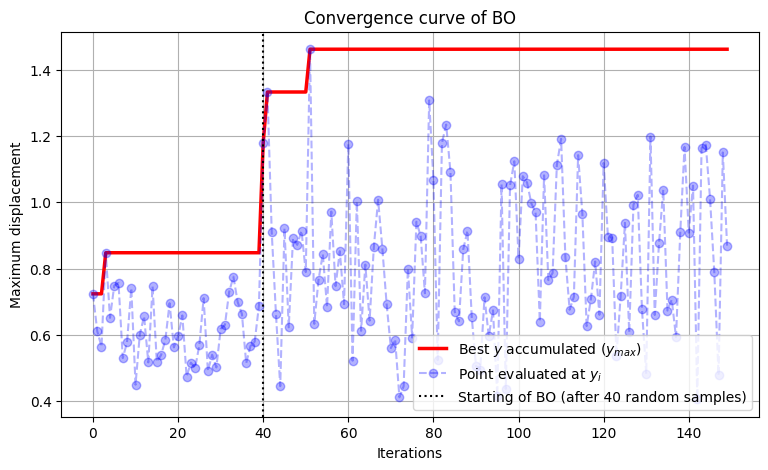
</p>

During the 40 random samples the best value plateaus near **0.85 m**. Two iterations after BO starts it jumps to **1.34 m**, and by iteration 51 it reaches **1.46 m**. The evaluations keep scattering afterwards (0.4–1.3 m), which shows the acquisition is still balancing exploration and exploitation.

**Robustness across random seeds.** Over 5 seeds, every run shows the same sharp gain once surrogate-guided search starts, ending around **1.29 ± 0.04 m**:

<p align="center">
  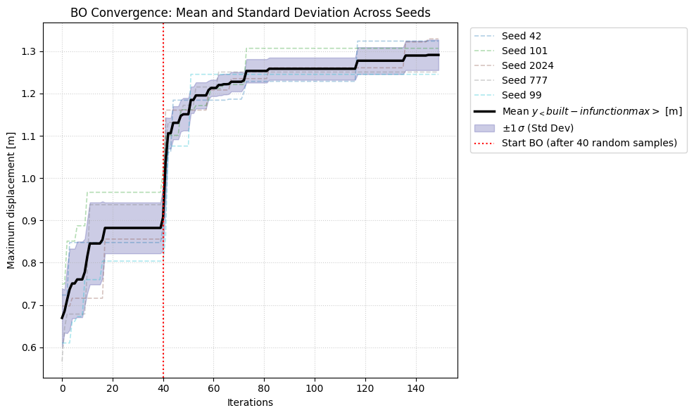
</p>

**GP-Hedge acquisition.** An adaptive portfolio (`gp_hedge`) chooses among **EI, PI and UCB** at each step according to their past gains. With 200 evaluations it settles into exploiting a peak at **≈ 1.67 m**, and this was the BO configuration used from here on:

<p align="center">
  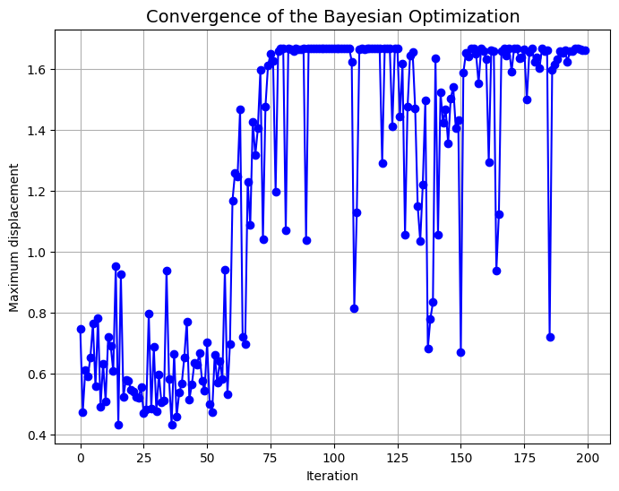
</p>

> **Note:** this value is higher than the DE result (1.577 m). DE is a stochastic global heuristic, so its result is a strong reference but not a certified global optimum. Each BO evaluation is a true ODE run, so the 1.67 m is a real simulated displacement.

### 5.7 Inverse problem with the GP surrogate

The base is fixed ($`K_b`$ = 4889.12 N/m, $`M_b`$ = 10 kg, $`h_b`$ = 0.1), leaving a 6-D decision space. For each target in $`[0.75, 1.70]`$ m (step 0.002 m), the **GP mean** is driven onto the target:

```math
\boldsymbol\theta^*_{free}(y_{target}) = \arg\min_{\boldsymbol\theta_{free}} \big(\mu_{GP}(\boldsymbol\theta_{free};\ K_b, M_b, h_b) - y_{target}\big)^2
```

The problem is solved with **L-BFGS-B**, **warm-started** from the previous target's solution so the parameter path stays continuous. Every 10th solution was checked against the ODE:

| Target vs GP vs ODE | Point-wise relative error |
|---|---|
| 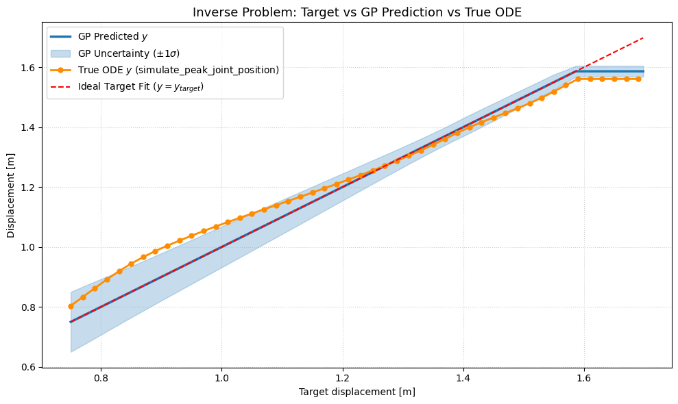 | 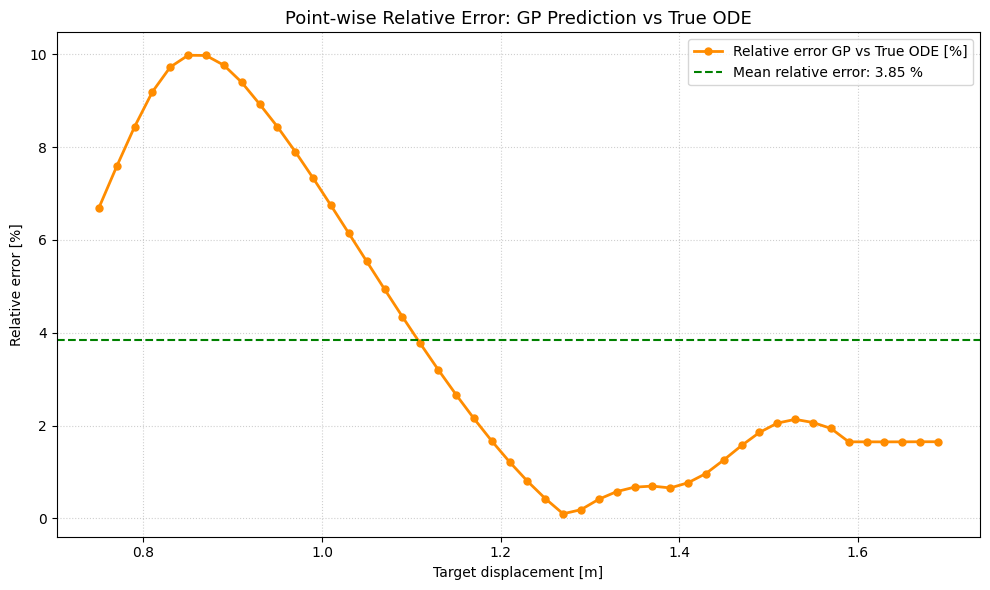 |

- Mean relative error **≈ 3.9 %**. It drops **below 2 %** in the range 1.15–1.58 m, with a minimum of **0.12 % at 1.27 m**, because BO sampled the high-displacement resonant region densely.
- The largest error (**≈ 10 % near 0.86 m**) occurs where BO collected few samples and the small denominator inflates the percentage.
- Above **≈ 1.58 m**, both the GP and the ODE **plateau**. This is the physical resonance limit of that base: no tuning of the robot parameters can go further.

---

## 6. Approach 3 – Neural network surrogate

### 6.1 Architecture

A feed-forward **MLP** learns $`f_\Theta:\mathbb{R}^9\to\mathbb{R}`$, $`\hat{y}_{max} = f_\Theta(\boldsymbol\theta)`$, trained on the large LHS simulation dataset:

<p align="center">
  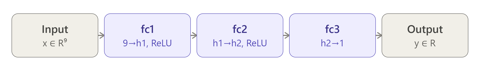
</p>

```math
\mathbf{h}_1 = \text{ReLU}(W_1\boldsymbol\theta + \mathbf{b}_1), \qquad
\mathbf{h}_2 = \text{ReLU}(W_2\mathbf{h}_1 + \mathbf{b}_2), \qquad
\hat{y}_{max} = W_3\mathbf{h}_2 + b_3
```

with hidden sizes **64 and 32**, parameters $`\Theta = \{W_1, \mathbf{b}_1, W_2, \mathbf{b}_2, W_3, b_3\}`$, MSE loss, and inputs normalized to $`[0,1]^9`$.

### 6.2 Training

<p align="center">
  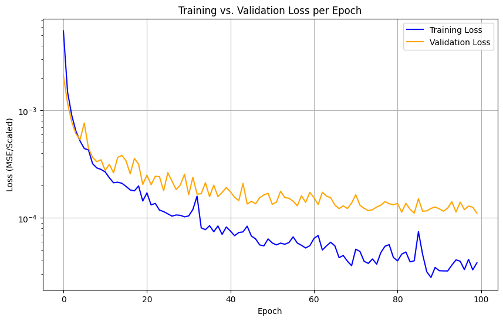
</p>

The loss falls by more than an order of magnitude in the first 20 epochs. The validation loss levels off near $`10^{-4}`$ after epoch 40 and **never rises again**, so there is **no overfitting**. Validation and test losses are of the same order.

| Parity – train | Parity – validation |
|---|---|
| 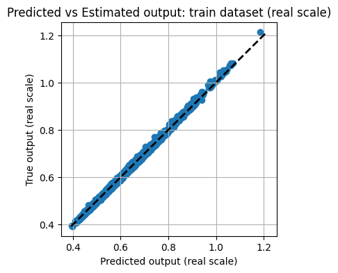 | 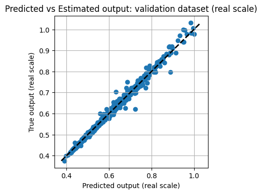 |

### 6.3 Physical consistency: sensitivity to robot damping

A random test configuration (index 1309) was taken, and $`h_r`$ was swept from 0.1 to 1.1 while all other parameters stayed fixed. The NN reproduces the ODE trend: the peak drops sharply from about 1.05 m to 0.60 m as $`h_r`$ goes from 0.1 to 0.5, then flattens near 0.58 m. The absolute error is at most **0.02 m**, at the lightly damped end where gradients are steepest, and stays below **0.005 m** for $`h_r \ge 0.3`$.

<p align="center">
  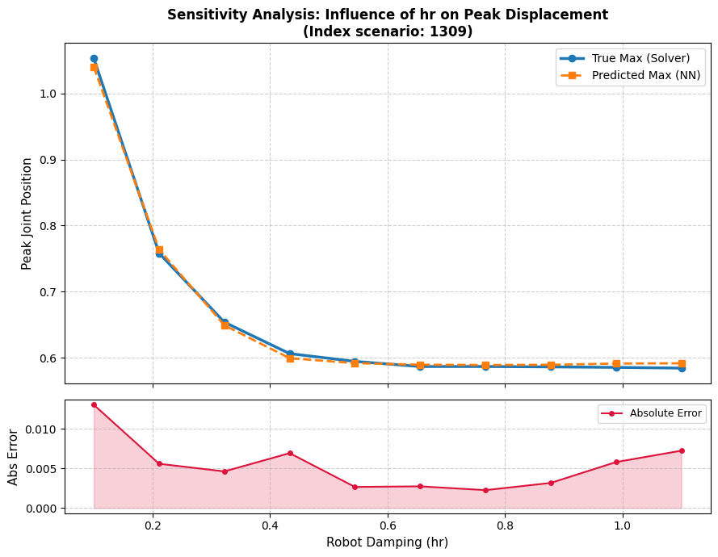
</p>

This independently confirms the GP's ARD finding that $`h_r`$ is the dominant parameter.

### 6.4 Error analysis

| Relative error distribution (test) | Where are the high-error samples? |
|---|---|
| 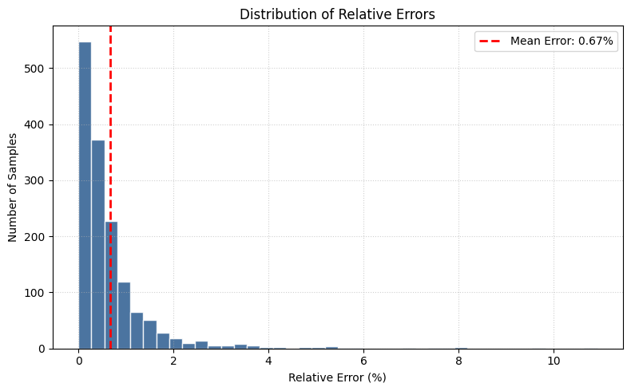 | 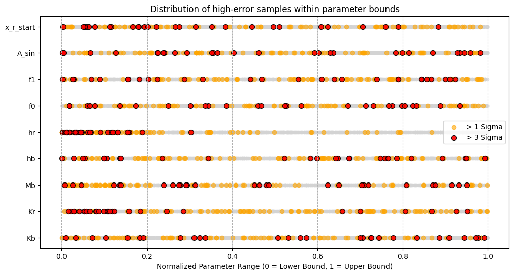 |

- **Mean relative error 0.67 %**. Most samples are below 2 %, with rare outliers (about 13 %) at low displacements.
- Samples with errors above 3σ **cluster at the domain boundaries**, mostly in $`h_r`$, $`K_r`$ and $`x_{r,start}`$, where sampling density is lower and the ODE gradients are steeper. The central region (normalized 0.3–0.7) is very accurate.

### 6.5 Direct problem: maximum reach

- A single-start **L-BFGS-B** from the domain midpoint gets stuck in a local maximum at **0.567 m**, which shows the response surface is non-convex.
- A **Monte Carlo search over 500 000** vectorized surrogate evaluations (a few seconds of runtime) finds **1.1765 m**. That is twice the local optimum, which shows that global or multi-start strategies are needed on this landscape.

| Parameter | $`K_b`$ | $`K_r`$ | $`M_b`$ | $`h_b`$ | $`h_r`$ | $`f_0`$ | $`f_1`$ | $`A_{sin}`$ | $`x_{r,start}`$ | **$`\hat y_{max}`$** |
|---|---|---|---|---|---|---|---|---|---|---|
| Value | 1938.55 | 2303.44 | 94.36 | 0.117 | 0.101 | 0.0048 | 5.458 | 0.199 | 0.493 | **1.1796 m** |

### 6.6 Inverse problem: gradient-based input optimization (autograd)

Instead of training an *inverse* network (which would be ill-posed, since many designs give the same peak), the trained network is **frozen** and the gradient of the loss is backpropagated **with respect to the inputs**:

```math
\boldsymbol\theta^*_{free} = \arg\min_{\boldsymbol\theta_{free}\in[0,1]^6} \big(f_\Theta(\boldsymbol\theta_{free};\ K_b, M_b, h_b) - y_{target}\big)^2
```

This is solved with **PyTorch autograd + Adam** over 300 steps.

**Single validation case:** base $`K_b`$ = 2608.32 N/m, $`M_b`$ = 98.14 kg, $`h_b`$ = 0.269, target 1.12 m. The NN predicts 1.1200 m and the ODE gives **1.1838 m** (5.7 % error).

**Target sweep on two different bases** (each solution checked with the ODE):

| Base A ($`K_b`$ = 2608 N/m, $`M_b`$ = 98 kg) | Base B (SB optimum: $`K_b`$ = 4889 N/m, $`M_b`$ = 10 kg) |
|---|---|
| 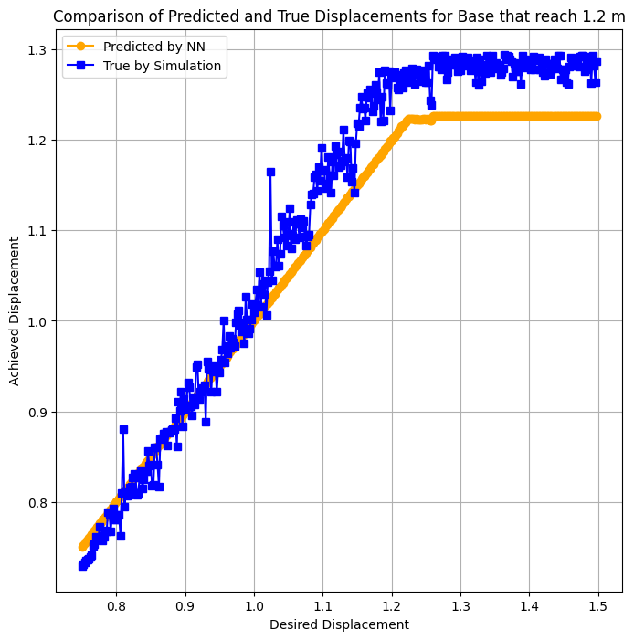 | 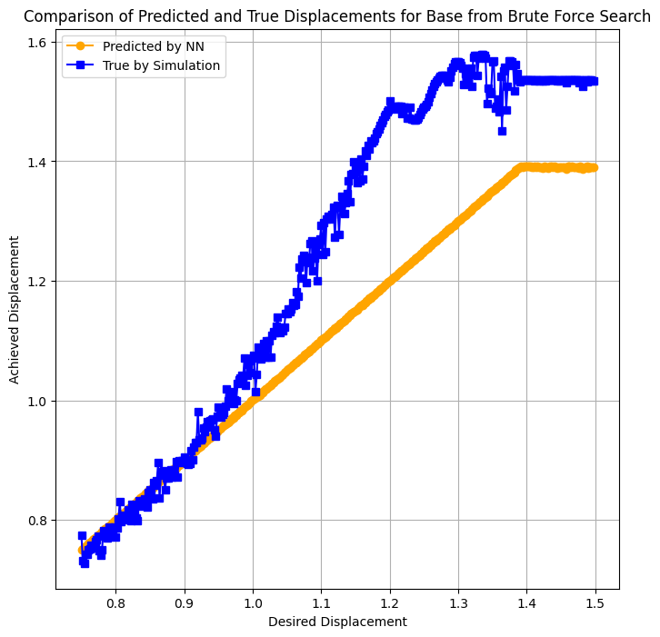 |
| 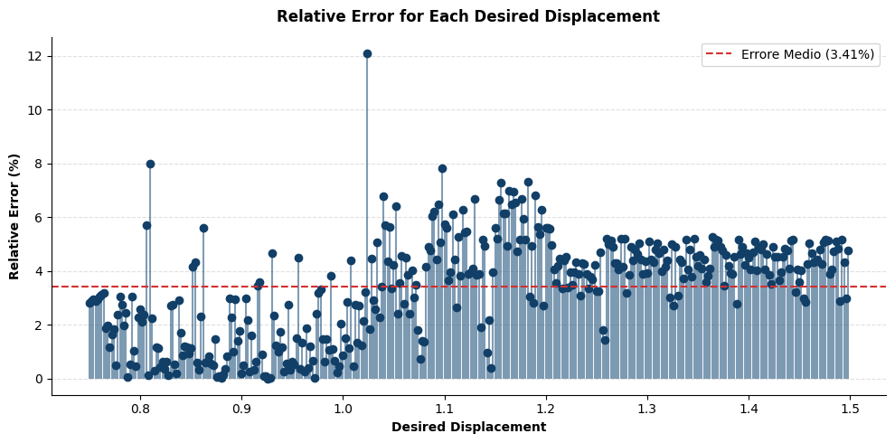 | 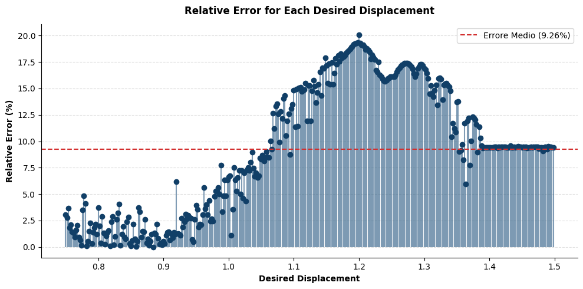 |
| Mean relative error **3.41 %**. The NN saturates at ≈ 1.22 m while the ODE reaches ≈ 1.28 m | Mean relative error **9.28 %**. Good tracking up to ≈ 1.0 m, then the NN saturates (≈ 1.39 m) well below the true capability (≈ 1.53 m) |

**Interpretation:** accuracy is high *inside the training distribution*. Configurations that reach large displacements are rare in a uniform LHS dataset (see the [peak distribution](#4-approach-1--semi-brute-force-baseline-lhs--differential-evolution)), so the NN under-predicts the extreme resonant region. Refined sampling near the peak, or active learning, would fix this.

---

## 7. Comparison of approaches

| | Semi-brute force (DE + ODE) | GP + Bayesian Optimization | Neural network |
|---|---|---|---|
| **Max reach found** | 1.577 m | 1.46 m (EI, 150 evals) · ≈1.67 m (GP-Hedge, 200 evals) | 1.18 m (surrogate MC) |
| **Inverse accuracy** | ~0 error (1.12 → 1.12002 m) | < 2 % in the 1.15–1.58 m range, ≈ 3.9 % mean | 3.4 % – 9.3 % mean, depending on the base |
| **Cost** | ≈ 5 min direct, ≈ 1.4 min per inverse target | Few hundred ODE calls; uncertainty-guided | Training once, then **seconds** for 500k queries |
| **Uncertainty** | – | ✅ calibrated predictive variance | ❌ point estimate |
| **Interpretability** | Optimal parameters | ✅ ARD sensitivity | Sensitivity via sweeps |
| **Best for** | Ground truth / final validation | Sample-efficient global search on an expensive simulator | Massive sampling, differentiable inverse design, real-time use |

---

## 8. Key takeaways and future work

**Takeaways**

- **Exploiting base compliance more than doubles the reach** (about 0.7 m nominal → over 1.5 m dynamic) by tuning the system for resonant energy transfer through a chirp excitation.
- Physics and data agree: **robot-joint damping $`h_r`$ and base mass $`M_b`$** dominate the reach (GP ARD + NN sensitivity).
- The response surface is **non-convex**, so local optimizers fail. Global sampling, DE or BO are needed.
- **Kernel/prior choice matters**: a rough kernel (Matérn 3/2) with short length-scales captures sharp resonances, while smooth priors underfit.
- Surrogates are **trustworthy only inside their data distribution**. Every surrogate-based design was validated against the true ODE.

**Possible extensions**

- Active learning / adaptive sampling focused on the high-displacement tail to improve NN accuracy near the reach limit.
- Multi-start or evolutionary search on the NN surrogate (DE, CMA-ES) and Bayesian NNs or deep ensembles for uncertainty.
- Physics-informed NNs or residual models (analytical FRF + learned correction).
- Reinforcement learning for a closed-loop excitation policy instead of a parametric chirp.
- Adding constraints (base displacement, actuator force or velocity limits) and robustness to parameter uncertainty.

---

## 9. Tech stack

`Python` · `NumPy` · `SciPy` (RK45 `solve_ivp`, Differential Evolution, L-BFGS-B, LHS) · `scikit-learn` (`GaussianProcessRegressor`, `StandardScaler`, `MinMaxScaler`) · `scikit-optimize` (`gp_minimize`, EI / GP-Hedge) · `PyTorch` (MLP, autograd inverse design) · `Matplotlib` / `Seaborn`

---

## 10. References

1. L. Roveda, N. Pedrocchi, F. Vicentini, L. Molinari Tosatti, "An interaction controller formulation to systematically avoid force overshoots through impedance shaping method with compliant robot base," *Mechatronics*, vol. 39, pp. 42–53, Oct. 2016.
2. C. E. Rasmussen, C. K. I. Williams, *Gaussian Processes for Machine Learning*, MIT Press, 2006.
3. R. Storn, K. Price, "Differential Evolution – A simple and efficient heuristic for global optimization over continuous spaces," *Journal of Global Optimization*, 11, 1997.
4. J. Snoek, H. Larochelle, R. P. Adams, "Practical Bayesian Optimization of Machine Learning Algorithms," *NeurIPS*, 2012.

---

<sub>Academic project developed for the course *Machine Learning for Mechanical Systems*, Politecnico di Milano, A.Y. 2025/26.</sub>
